# Software Architecture Document (SAD): kvolegi-arcade 🕹️

> **Standard:** ISO/IEC/IEEE 42010 Architecture Description & Hexagonal Architecture  
> **Status:** Production / Release v2.0.2  
> **System Class:** Custom Multiplatform 2D Retro Arcade Engine & Simulation Suite  
> **Author & Lead Architect:** `@kvolegi`

---

## 1. Executive Architectural Overview

`kvolegi-arcade` is an engineered cross-platform 2D retro arcade suite designed and implemented from the ground up with **Zero External Game Engine Dependencies**. Instead of pulling heavyweight third-party frameworks (such as Unity, Godot, or LibGDX, which introduce 30–60 MB of runtime overhead), the project implements a clean **Hexagonal (Ports & Adapters)** architecture in standard Java.

The entire core game simulation, mathematical vector operations, collision detection, and heuristics are 100% decoupled from any graphical windowing toolkit or operating system API.

The suite bundles four complete game simulations:
1. **Tic Tac Toe (Neon Edition)** — Dynamic expanding grid (5x5 up to 25x25), 5-in-a-row win conditions, and a 4-vector threat-evaluation heuristic AI.
2. **Sigma Slots** — 4x5 reel matrix with 20 payout paylines, balanced volatility math, Wild/Scatter bonus mechanics, and paytable logic.
3. **Beer Snake** — Multi-speed arcade snake with 25 progression tiers, switchable toroidal wrap-around vs solid wall collision physics.
4. **Bobr Minesweeper** — Beaver & Broccoli tactical minesweeper featuring guaranteed first-click safety, Sonar Radar pulses, and customizable field densities.

---

## 2. Hexagonal Architecture (Ports & Adapters)

```mermaid
flowchart TD
    subgraph CoreDomain ["Platform-Agnostic Core Domain (source/core/arcade)"]
        GameEngine["Game Controller & State Machines\n(App, Snake, Mines, Slots, TicTacToe)"]
        FixedLoop["Fixed-Timestep Game Loop\n(Accumulator stepT += dt)"]
        MathUtils["Math & Color Utilities\n(C.java, Art.java - Packed ARGB)"]
        UiState["Ui State & Input Controller\n(ReentrantLock Loom-Safe Pipeline)"]
        
        PortGfx["<<Interface Port>>\nGfx (Rendering)"]
        PortStore["<<Interface Port>>\nStore (Persistence)"]
        
        GameEngine --> FixedLoop
        GameEngine --> MathUtils
        GameEngine --> UiState
        GameEngine --> PortGfx
        GameEngine --> PortStore
    end

    subgraph DesktopAdapter ["Desktop Adapter (source/desktop)"]
        JFX_Gfx["JavaFX Canvas Renderer\n(JavaFxGfx.java)"]
        AWT_Launcher["Desktop Launcher & Frame\n(App.java)"]
        File_Store["Local File Store\n(High Scores & Settings)"]
        
        JFX_Gfx -.->|Implements| PortGfx
        File_Store -.->|Implements| PortStore
    end

    subgraph AndroidAdapter ["Android Adapter (source/android)"]
        Android_Canvas["Native SurfaceView Canvas\n(ArcadeView.java)"]
        Android_Store["SharedPreferences Store\n(PrefsStore.java)"]
        
        Android_Canvas -.->|Implements| PortGfx
        Android_Store -.->|Implements| PortStore
    end

    subgraph HeadlessTesting ["Headless Test Harness (tests/)"]
        VirtualCanvas["HeadlessRecordingGfx\n(Frame Timing & Command Verification)"]
        ArcadeDomainTest["ArcadeDomainTest (JUnit 5)\n(1000-Frame Headless Simulation)"]
        
        VirtualCanvas -.->|Implements| PortGfx
        ArcadeDomainTest --> VirtualCanvas
        ArcadeDomainTest --> GameEngine
    end
```



### 2.1. Inversion of Control & Port Isolation
* **`Gfx` Port:** Declares basic rendering primitives (`cls`, `frect`, `rect`, `line`, `txt`, `img`, `blend`). The core never imports `java.awt.Graphics`, `javafx.scene.canvas.Canvas`, or `android.graphics.Canvas`.
* **`Store` Port:** Declares persistence abstractions (`getInt`, `putInt`, `getString`, `putString`). On desktop, it serializes to local config files; on mobile, it integrates with Android `SharedPreferences`.
* **`Ui` Port:** Buffers immediate-mode inputs (pointer position, touch coordinates, swipe vectors, and key events).

---

## 3. High-Performance 60 FPS Render Loop & Fixed Timestep

A common pitfall in game development is linking game physics directly to the rendering frame rate ($FPS$). If the screen refreshes at 144 Hz, physics run 2.4x faster; if the machine drops to 30 Hz, physics slow down.

`kvolegi-arcade` decouples rendering from physics via a **Fixed-Timestep Accumulator** in `Snake.java`:
```java
stepT += dt;
int guard = 0;
while (stepT >= delay && guard < 4) {
    tick();
    stepT -= delay;
    guard++;
}
```
* **Predictability:** Physics update in discrete, deterministic intervals (`delay`), while rendering interpolation runs smoothly at whatever frame rate the display hardware supports.
* **Spiral-of-Death Protection:** The `guard < 4` check prevents infinite simulation loops on slower CPUs during unexpected system freezes.

---

## 4. Memory Management: Zero-Allocation Render Loop

At 60 frames per second, allocating temporary heap objects (`new Color()`, `new Point()`, `new Rect()`) forces the JVM Garbage Collector to run frequently, resulting in noticeable frame drops (micro-stutter).

### 4.1. Packed 32-Bit ARGB Primitives
All colors are passed and manipulated as unboxed primitive `int` values:
```java
public static int rgba(int r, int g, int b, int a) {
    return ((a & 0xFF) << 24) | ((r & 0xFF) << 16) | ((g & 0xFF) << 8) | (b & 0xFF);
}
```
Alpha blending, brightness adjustments, and RGB neon bloom transitions execute via bitwise shifts (`>>`, `<<`, `&`, `|`), eliminating `java.awt.Color` allocations entirely.

### 4.2. Pre-Allocated Particle & Vector Arrays
Dynamic effects (such as neon sparkles and coin cascades) reuse fixed-size primitive arrays (`float[] px`, `float[] py`, `float[] vx`, `float[] vy`), keeping the runtime garbage collector idle during active gameplay.

---

## 5. Concurrency & Java 21 Project Loom Thread Safety

### 5.1. Preventing Virtual Thread Pinning
In traditional Java, object monitors (`synchronized (lock)`) pin virtual threads to their underlying operating system carrier threads when running under Java 21 Project Loom executors. 

In `Ui.java`, all synchronization primitives are implemented with explicit `java.util.concurrent.locks.ReentrantLock`:
```java
private final ReentrantLock inputLock = new ReentrantLock();

public void key(String k) {
    inputLock.lock();
    try {
        keys.add(k);
        if (keys.size() > 16) keys.poll();
    } finally {
        inputLock.unlock();
    }
}

public String pollKey() {
    inputLock.lock();
    try {
        return keys.poll();
    } finally {
        inputLock.unlock();
    }
}
```
* **Loom Safety:** Reentrant locks allow virtual threads to cleanly yield (unmount) during lock contention without pinning carrier OS threads.
* **Race Condition Elimination:** Guards the key queue (`ArrayDeque<String>`) and touch pointer coordinates against concurrent modification between the OS event dispatch thread (AWT-EventQueue / Android UI thread) and the game rendering thread.

---

## 6. Game Mathematics & Heuristic AI

### 6.1. Dynamic Centered Matrix Expansion (Tic Tac Toe)
Rather than a fixed 3x3 grid, the board expands dynamically from $5 \times 5$ up to $25 \times 25$ as moves are played:
* **Expansion Trigger:** When more than 50% of the active cells are filled, the matrix expands by 5 rows and 5 columns.
* **Centered Coordinate Remapping:** Existing moves are translated to the new center using:
  $$\Delta = \frac{N_{\text{new}} - N_{\text{old}}}{2}, \quad (r', c') = (r + \Delta, c + \Delta)$$
* **Threat-Evaluation AI Engine:** Evaluates lines across 4 vectors ($[0,1]$, $[1,0]$, $[1,1]$, $[1,-1]$), prioritizing immediate 5-in-a-row wins ($+50,000$ pts), blocking opponent 4-in-a-row threats ($+15,000$ pts), and optimizing branching double-open lines.

### 6.2. Toroidal Wrap-Around Topology (Beer Snake)
Snake world boundaries can toggle between solid walls and a toroidal wrap-around manifold:
$$x' = (x + \text{cols}) \pmod{\text{cols}}, \quad y' = (y + \text{rows}) \pmod{\text{rows}}$$

---

## 7. Multi-Platform Build & Code Signing Automation

The repository contains an automated build tool written in pure Python (`build_all.py`), which orchestrates multi-platform compilation without IDE or external plugin dependencies:

```
builds/
├── kvolegi-arcade-universal.jar  # Cross-platform Universal Fat JAR (Windows / Linux / macOS)
├── mac/
│   ├── kvolegi arcade.app        # macOS Application Bundle (Signed with ad-hoc codesign)
│   └── kvolegi-arcade-mac.jar    # macOS-specific bundle
├── windows/
│   └── kvolegi-arcade-windows.jar# Windows-specific bundle
└── android/
    └── kvolegi-arcade.apk        # Signed Release Android APK (5.9 MB)
```

* **Automated Code Signing:** Directly triggers macOS `codesign --force --deep --sign -` on the generated `.app` bundle, ensuring seamless execution on modern macOS Gatekeeper environments.
* **D8 Desugaring & Alignment:** Executes Android `d8` bytecode desugaring and `zipalign` 4-byte boundary alignment to produce production-ready APKs.

---

## 8. Verification & Headless Testing Matrix

The suite is validated by automated JUnit 5 tests running on a virtual headless canvas (`HeadlessRecordingGfx`):
* **Tick Determinism:** Simulates 1,000 game frames offline without graphical display hardware or windowing toolkits.
* **State Verification:** Validates grid expansions, collision detection boundaries, level progression speeds, and paytable evaluations under continuous execution.
