# kvolegi arcade 🕹️✨

<p align="center">
  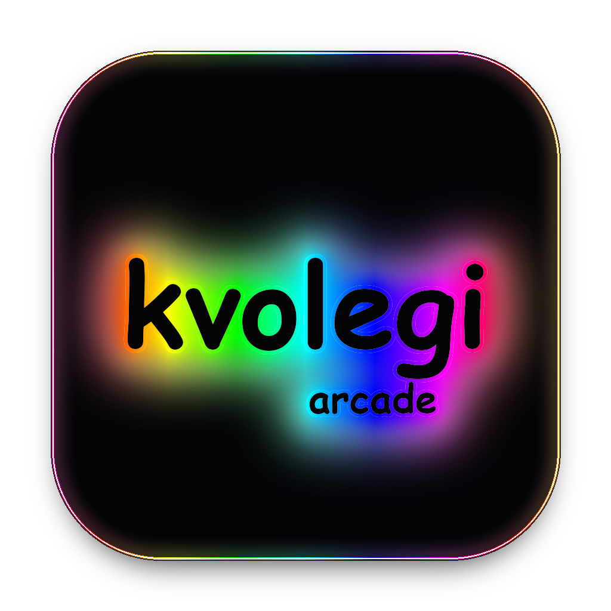
</p>

<p align="center">
  <strong>Production-Grade Multiplatform Retro-Neon Arcade Game Suite</strong><br>
  <em>Engineered by <strong>@kvolegi</strong> • Development Timeline: <strong>2023 – 2024</strong></em>
</p>

<p align="center">
  
  
  
  
  
</p>

---

## 🌟 Executive Summary

**kvolegi arcade** is an advanced, high-performance cross-platform gaming ecosystem developed from scratch between **November 2023 and February 2024**. The project showcases enterprise-grade software architecture, cross-platform code sharing, custom low-level 2D rendering, high-stakes game mathematics, and real-time heuristics.

The suite bundles **four fully featured arcade games** wrapped in a unified Cyberpunk / Neon aesthetic with dynamic RGB rainbow bloom effects:
1. **Tic Tac Toe (Neon Edition)** — Dynamic infinite memory-expanding grid (5x5 up to 25x25), 5-in-a-row victory criteria, Time-Attack Score Mode, and Nightmare-tier tactical AI.
2. **Sigma Slots** — 4x5 reel matrix featuring 20 authentic Las Vegas paylines, high-volatility payout distributions, Wild & Scatter bonus triggers, and interactive Pay Table.
3. **Beer Snake** — Precision arcade snake with 25 progressive difficulty tiers, toroidal wrap-around vs. solid collision mechanics, and dynamic speed interpolation.
4. **Bobr Minesweeper** — Beaver & Broccoli tactical minesweeper featuring guaranteed first-click safety, Sonar Radar pulse ability, and customizable field densities.

---

## 📸 Visual Showcase

### Desktop (JavaFX) vs Mobile (Native Android Canvas)

| Desktop Edition (Windows / macOS) | Mobile Edition (Android APK) |
| :---: | :---: |
| 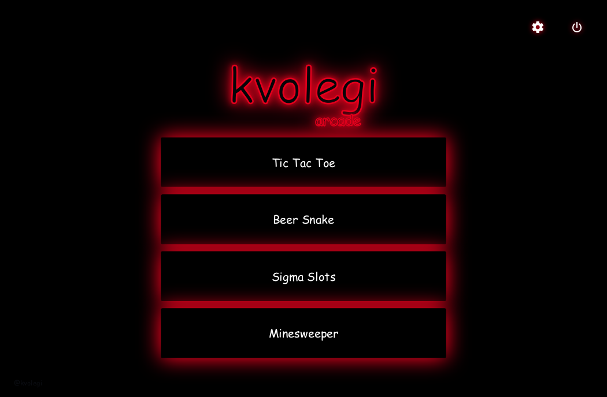 <br> *Main Arcade Hub (JavaFX GPU Bloom)* | 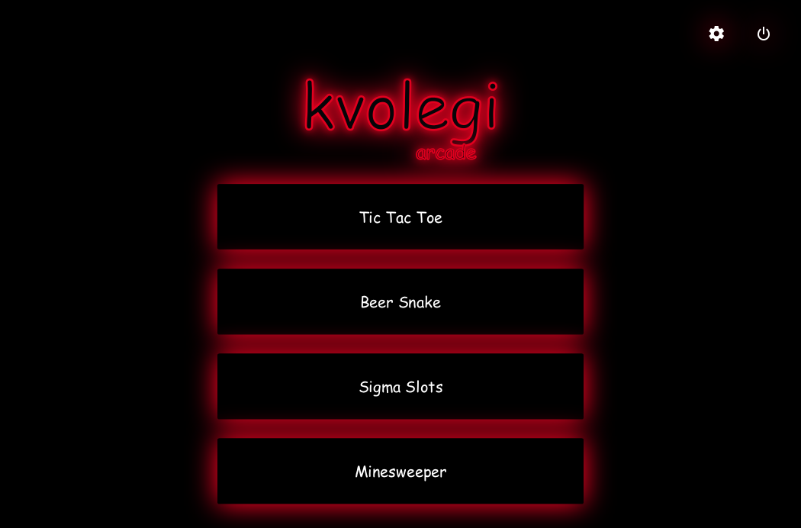 <br> *Main Arcade Hub (Android Native Surface)* |
| 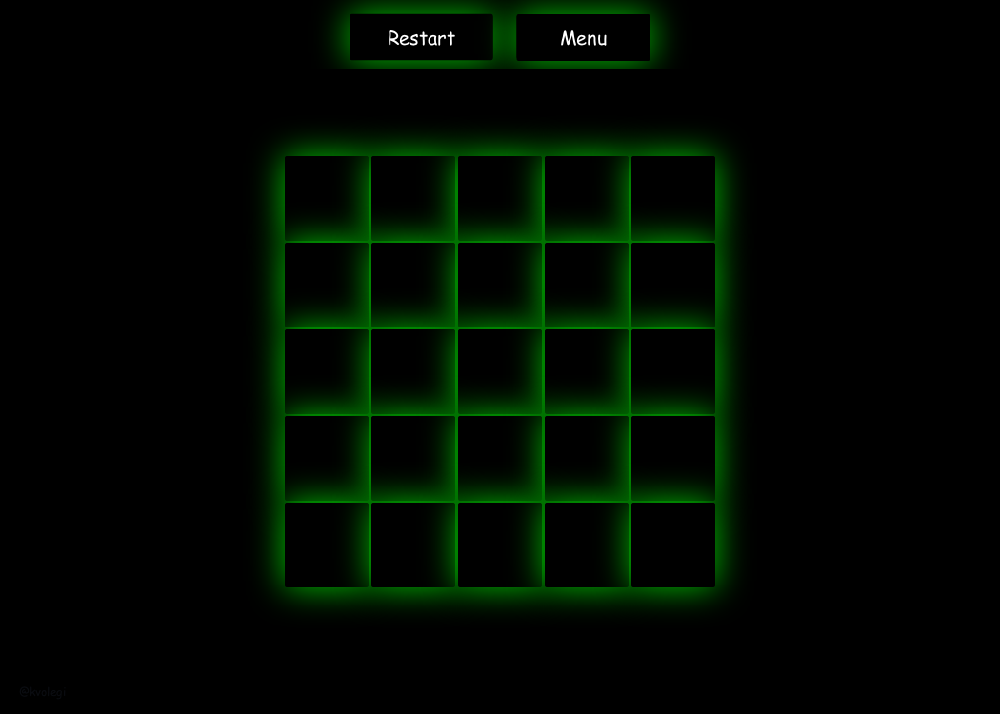 <br> *Infinite Memory Board (JavaFX)* | 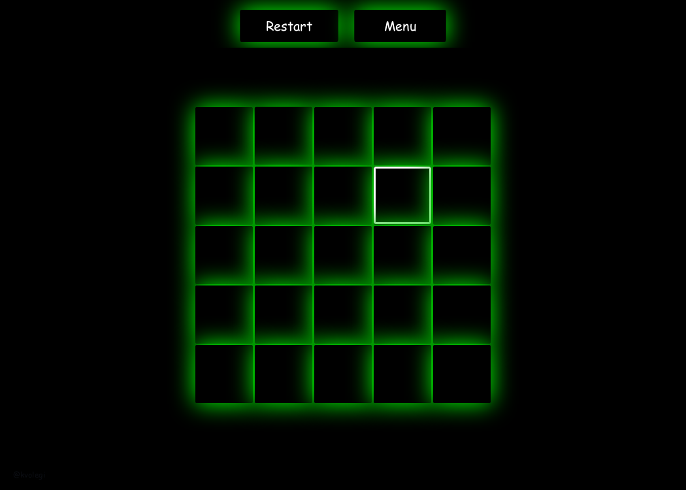 <br> *Infinite Memory Board (Android Canvas)* |
| 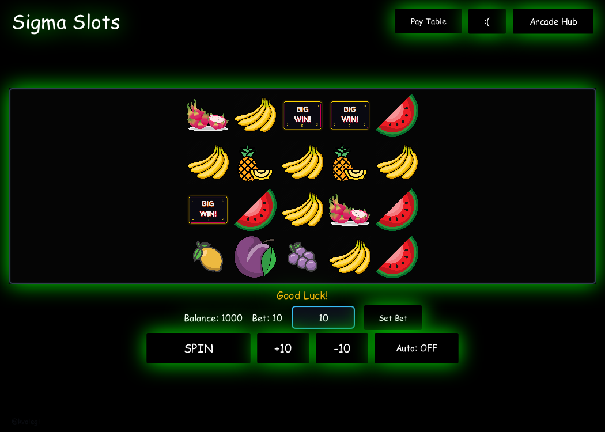 <br> *20-Line Vegas Slots (JavaFX)* | 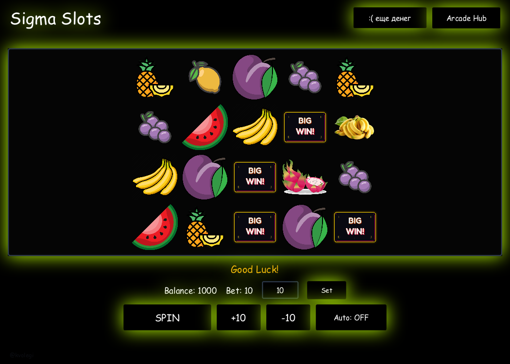 <br> *20-Line Vegas Slots (Android Surface)* |
| 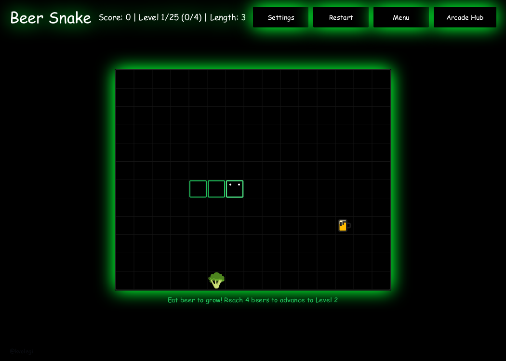 <br> *Beer Snake Game Loop (JavaFX)* | 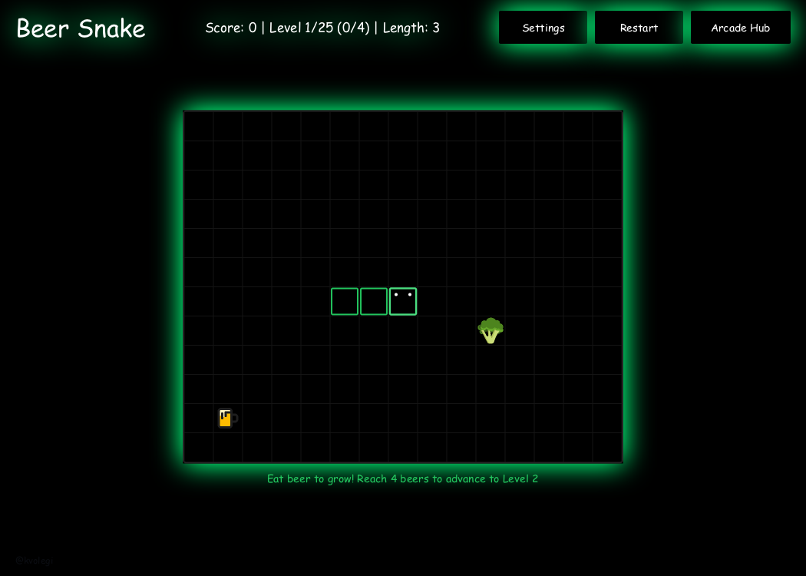 <br> *Beer Snake Game Loop (Android Canvas)* |
| 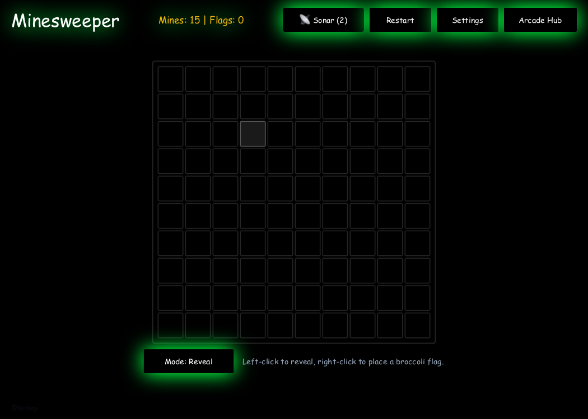 <br> *Bobr Minesweeper (JavaFX)* | 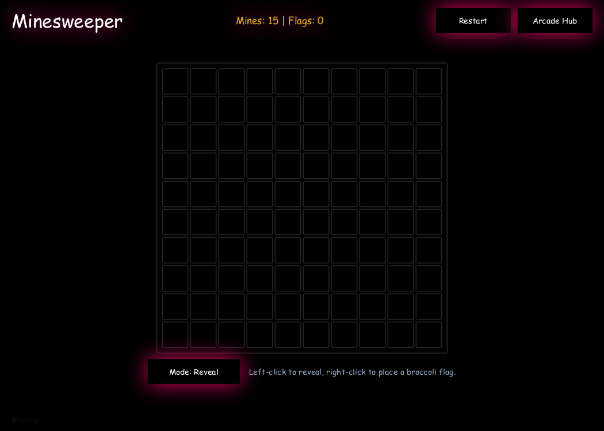 <br> *Bobr Minesweeper (Android Canvas)* |

---

## 🏗️ Architecture & Technical Decisions

The codebase strictly adheres to clean architectural principles, splitting the domain into **three decoupled tiers**:

```
kvolegi-arcade/
├── source/
│   ├── core/                  # Pure Java Standard Library (Zero external dependencies)
│   │   └── arcade/            # Game logic, state machines, math, data structures
│   ├── desktop/               # Desktop Frontend (JavaFX 21 + Reactive Controls)
│   │   └── arcade/desktop/    # Hardware-accelerated UI, Window management, Launch4j wrapper
│   └── android/               # Mobile Frontend (Android Native SDK)
│       └── src/main/java/     # SurfaceView, dedicated 60 FPS RenderThread, Touch dispatch
├── assets/                    # High-res PNG sprites, TTF fonts, audio FX
├── builds/                    # Pre-built distribution deliverables
│   ├── windows/               # kvolegi-arcade.exe (Native PE32) & runnable JAR
│   ├── mac/                   # kvolegi arcade.app & runnable JAR
│   └── android/               # kvolegi-arcade.apk (Signed Release APK)
└── docs/                      # Screenshots, technical documentation & specifications
```

### 1. Why JavaFX on Desktop?
* **Hardware-Accelerated Scene Graph:** JavaFX utilizes native GPU backends (DirectX 9/11 on Windows, Metal/OpenGL on macOS) allowing real-time CSS pseudo-class transitions, neon Gaussian drop-shadow filters, and fluid window resizing without frame dips.
* **Declarative Responsive Layouts:** Using hierarchical `BorderPane`, `VBox`, and `GridPane` containers with decoupled bounds recalculation (`widthProperty` and `heightProperty` invalidation listeners), the UI scales effortlessly from 800x600 windowed mode up to 4K Ultra-HD displays.
* **Precision Input Discarding:** Desktop controls implement explicit `setPickOnBounds(false)` overrides. This ensures large 50px Gaussian glow effects do not inflate the clickable bounding boxes, eliminating overlapping click-area conflicts.
* **Native OS Packaging:** The desktop engine packages directly into a standalone Windows `.exe` via Launch4j (with embedded JRE discovery and icon embedding) and a standard macOS `.app` bundle.

### 2. Why Native Android SurfaceView instead of Unity/LibGDX?
* **Featherlight Binary Footprint:** Heavy game engines like Unity or Godot introduce 30–60 MB of overhead and high RAM consumption. By implementing custom rendering on a native Android `SurfaceView` and `Canvas`, the entire game suite compiles to an ultra-compact **~5.6 MB APK**.
* **Direct 60 FPS Game Loop:** Rendering runs on a dedicated background `Thread` (`ArcadeView.java`) that locks and unlocks the hardware canvas via double-buffering (`surfaceHolder.lockCanvas()`). This completely isolates game computations from the Android OS UI thread.
* **Battery & Memory Optimization:** Minimal garbage collector pressure through object pooling and zero unnecessary allocations during the frame draw loop.
* **Seamless OS Integration:** Native dialog windows (`AlertDialog` with numerical `EditText` and system soft keyboard) are used for custom slot bet entries, ensuring a natural mobile user experience.

---

## 🧠 Engineering Highlights & Game Logic Deep-Dive

### 1. Tic Tac Toe — Dynamic Infinite Board with In-RAM Centered Expansion
Unlike conventional 3x3 Tic Tac Toe games, **kvolegi arcade** features an infinite board architecture:
* **In-RAM State Preservation:** The board starts at $5 \times 5$. As soon as more than 50% of the cells are populated, the game dynamically creates an expanded matrix $(N + 5) \times (N + 5)$ up to $25 \times 25$.
* **Center-Offset Coordinate Remapping:** Existing moves are mathematically transferred to the center of the expanded matrix using the offset formula:
  $$\Delta = \frac{N_{\text{new}} - N_{\text{old}}}{2}, \quad (r', c') = (r + \Delta, c + \Delta)$$
* **Adaptive Matrix Scaling:** Cell dimensions adaptively rescale in real-time:
  $$\text{cellSize} = \max\left(18, \min\left(88, \frac{\min(W_{\text{avail}}, H_{\text{avail}}) - (N - 1) \cdot \text{gap}}{N}\right)\right)$$
* **Tactical Threat-Evaluation AI:**
  The AI algorithm evaluates open-ended lines across four directional vectors: horizontal $[0, 1]$, vertical $[1, 0]$, main diagonal $[1, 1]$, and anti-diagonal $[1, -1]$. It prioritizes immediate 5-in-a-row wins ($+50,000$ pts), blocks opponent 4-in-a-row threats ($+15,000$ pts), and constructs branching double-threat fork attacks.

### 2. Sigma Slots — Authentic Las Vegas Payout Mathematics
* **4 Rows $\times$ 5 Reels Grid:** 20 distinct symbol positions evaluated every spin.
* **20 Authentic Paylines:** Formulated based on classic Nevada casino reel layouts, including straight lines, diagonal V-shapes, zigzags, and waveform patterns.
* **Volatility & RTP Balance:**
  * Low tier: Grape, Watermelon, Lemon, Plum, Pineapple ($0.18\times$ to $2.5\times$ bet).
  * Mid tier: Dragonfruit, Banana ($0.35\times$ to $6.0\times$ bet).
  * High tier (WILD): `BIGBANANA` ($1.8\times$ to $12.0\times$ bet, substitutes for standard symbols).
  * Jackpot tier (SCATTER): `BIGWIN` ($4.0\times$ to $30.0\times$ bet).
* **Direct Wager Window ("Віконечко"):** Allows players to increment bets by 10 or input custom bets directly via a native soft keyboard dialog.

### 3. Beer Snake — Dual-Mode Physics & Progression Curve
* **Level Progression:** 25 curated levels requiring 4 beer collectibles per stage with accelerating frame speed curves:
  $$\text{Delay}_{\text{tick}}(L) = \max\left(60\text{ms}, \text{Delay}_{\text{base}} - L \times 5\text{ms}\right)$$
* **Wall Collision Physics:** Supports toggleable game modes:
  * *Solid Walls:* Coordinate boundary checks trigger instant fatal game over.
  * *Toroidal Wrap-Around:* Coordinate modulo wrapping ($x' = (x + \text{cols}) \pmod{\text{cols}}$).

### 4. Bobr Minesweeper — Radar Mechanics & Matrix Generation
* **Guaranteed Safe First Click:** Mine matrix is generated only after the player's initial click, ensuring the first tile is always safe and opens adjacent zero-zones.
* **Sonar Pulse Mechanic:** Special tactical ability that reveals adjacent hidden beaver positions without the risk of detonation.
* **Dual-Action Touch Controller:** Effortless toggling between tile exploration and broccoli flag placement.

---

## 🚀 How to Run

### Windows (Native Executable)
1. Ensure Java 17 or 21+ is installed ([Download Adoptium Temurin](https://adoptium.net)).
2. Navigate to `builds/windows/` and double-click **`kvolegi-arcade.exe`**.
3. *(Alternative)* Run via `run_windows.bat` or `java -jar kvolegi-arcade-windows.jar`.

### macOS (Application Bundle)
1. Navigate to `builds/mac/`.
2. Double-click **`kvolegi arcade.app`**.
3. *(Alternative)* In Terminal, run:
   ```bash
   ./builds/mac/run_mac.sh
   ```

### Android (Mobile Device)
1. Transfer `builds/android/kvolegi-arcade.apk` to your Android device (Android 7.0 / API 24 or newer).
2. Tap the APK file to install and launch **kvolegi arcade**.

---

## 🛠️ How to Build from Source

### Prerequisites
* JDK 17 or JDK 21+
* Python 3.10+ (for build automation scripts)
* Android SDK Platform 35 & Build-Tools 35.0.0 (for Android packaging)

### Compile All Targets
```bash
# Compile Desktop JARs, macOS .app bundle, and Windows .exe
python3 build_all.py
```

---

## ⚖️ Intellectual Property & Copyright Notice

```
kvolegi arcade — Multiplatform Retro-Neon Arcade Suite
Copyright (c) 2023-2024 kvolegi (@kvolegi). All Rights Reserved.
```

This software and its associated documentation files are the proprietary intellectual property of **@kvolegi**.
- **Portfolio & Evaluation:** Code is made available for evaluation, non-commercial review, and educational demonstration only.
- **Watermark & Provenance:** The author's signature watermark `@kvolegi` is embedded directly into the UI canvas, rendering pipelines, and binary metadata.
- **Unauthorized Distribution:** Copying, commercial redistribution, or relicensing of this software without explicit prior written authorization is strictly prohibited.
