# kvolegi arcade 🕹️✨

<p align="center">
  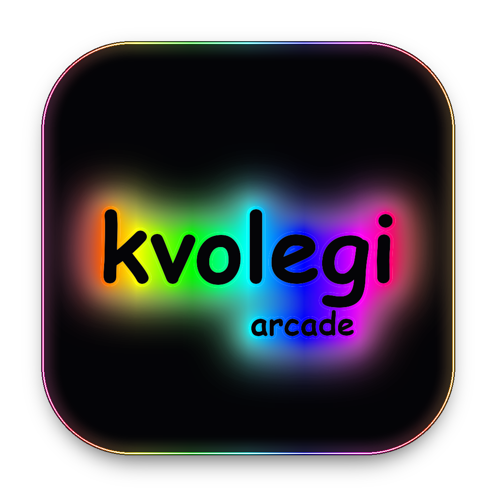
</p>

<p align="center">
  <strong>Cross-Platform Retro-Neon Arcade Suite & Custom 2D Engine</strong><br>
  <em>Engineered from scratch with Zero Third-Party Engine Dependencies (No LibGDX / No Unity) • <strong>@kvolegi</strong></em>
</p>

<p align="center">
  
  
  
  
  
  
  
  <a href="https://github.com/kvolegi/kvolegi-arcade/releases/tag/v2.1.0"></a>
</p>

---

## About the Project

**kvolegi arcade** is a standalone cross-platform arcade hub written in Java. The project was built from scratch between November 2023 and April 2024 to explore custom 2D rendering, cross-platform code sharing without third-party game engines, game mathematics, and real-time heuristics.

The suite bundles four complete arcade games with a shared Cyberpunk / Neon visual style and dynamic RGB bloom:
1. **Tic Tac Toe (Neon Edition)** — Dynamic expanding grid (from 5x5 up to 25x25), 5-in-a-row win condition, Time-Attack score mode, and heuristic threat-evaluation AI.
2. **Sigma Slots** — 4x5 reel matrix with 20 classic casino paylines, balanced volatility, Wild & Scatter bonus mechanics, and an interactive paytable.
3. **Beer Snake** — Classic arcade snake with 25 progression levels, switchable toroidal wrap-around vs. solid wall collision, and dynamic speed scaling.
4. **Bobr Minesweeper** — Beaver & Broccoli tactical minesweeper featuring guaranteed first-click safety, Sonar Radar pulse ability, and custom field densities.

---

## 📸 Screenshots

### Desktop (JavaFX 21) vs Mobile (Native Android SurfaceView)

| Desktop Edition (macOS / Linux / Windows) | Mobile Edition (Android APK) |
| :---: | :---: |
| 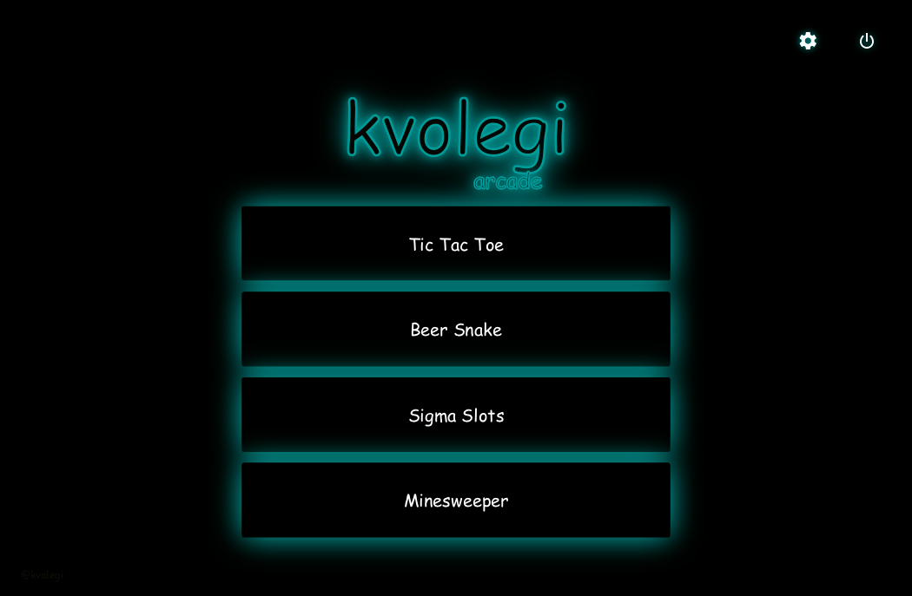 <br> *Main Arcade Hub (JavaFX Desktop)* | 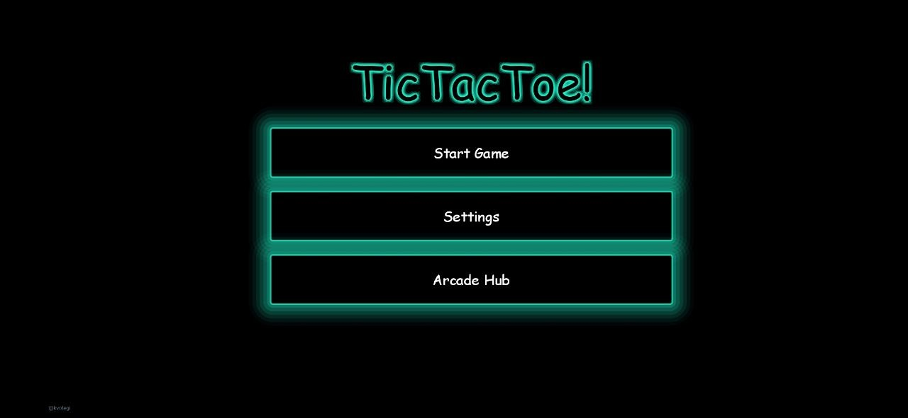 <br> *Main Arcade Hub (Native Android)* |
| 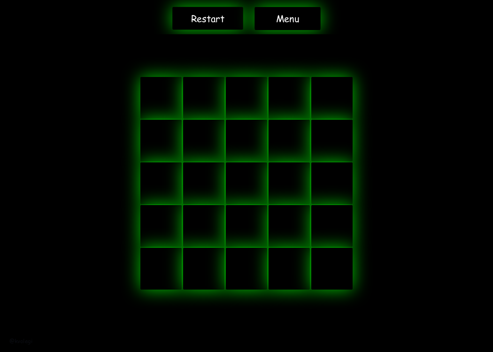 <br> *Adaptive Grid (5x5 → 25x25 Dynamic Expansion)* | 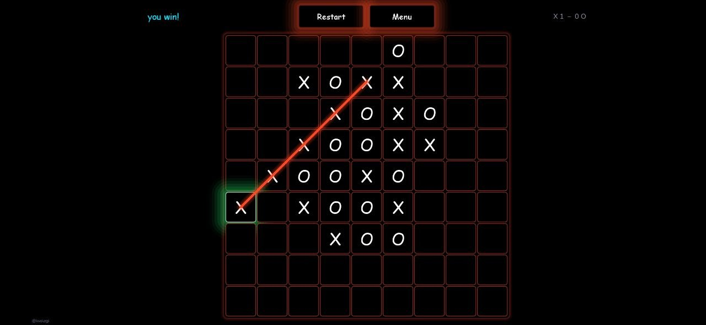 <br> *Tactical Grid (5-in-a-Row Victory State)* |
| 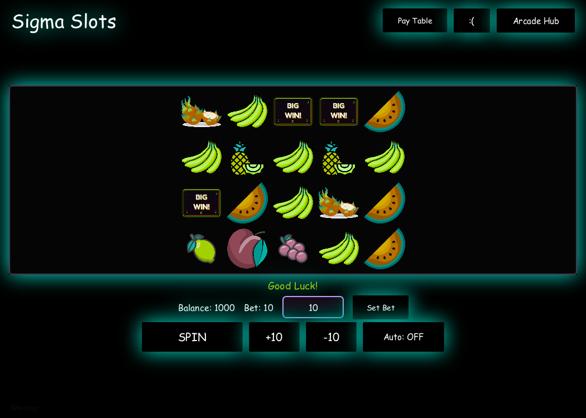 <br> *20-Line Vegas Slots (Reel Matrix & Payouts)* | 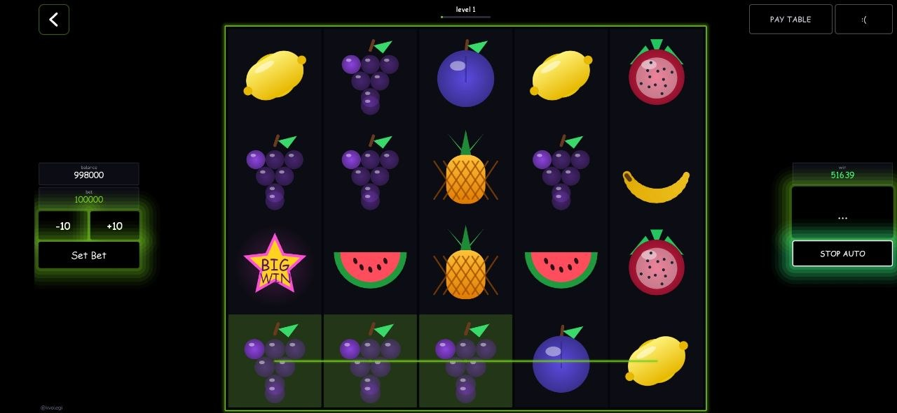 <br> *20-Line Vegas Slots (Auto-Spin & Bets)* |
| 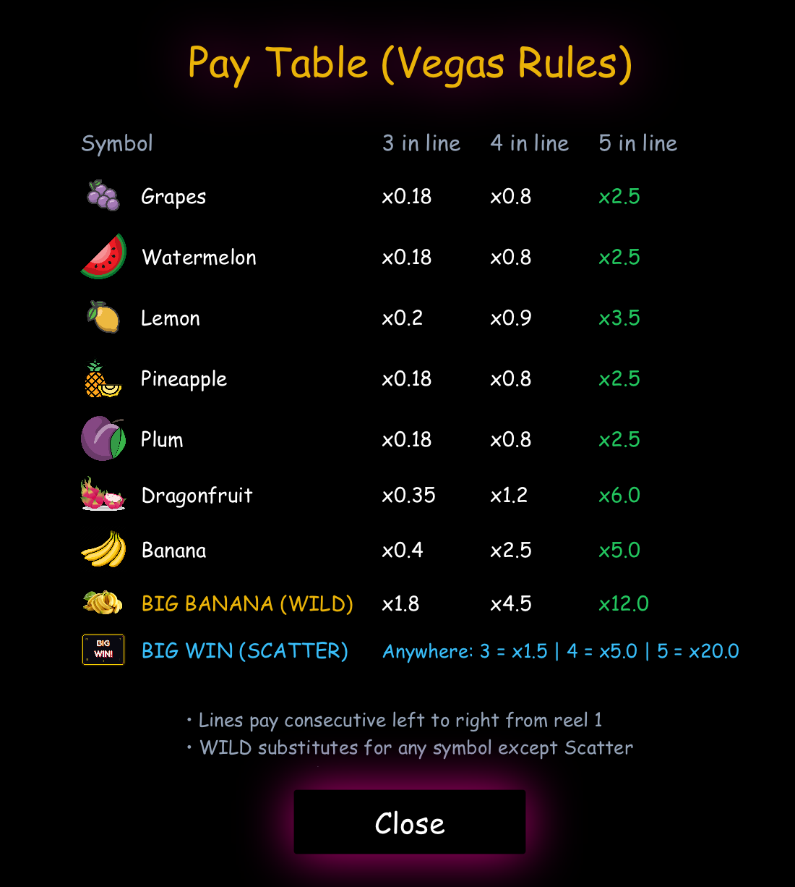 <br> *High-Res Vegas Pay Table Modal* | 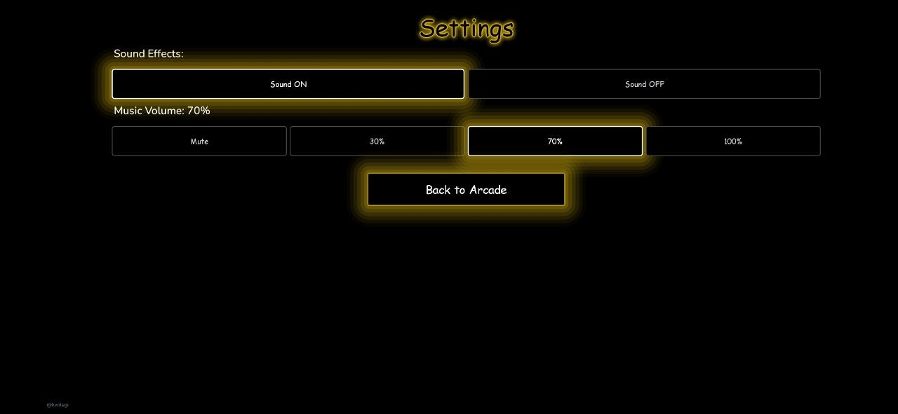 <br> *Audio & Sound Settings Overlay* |
| 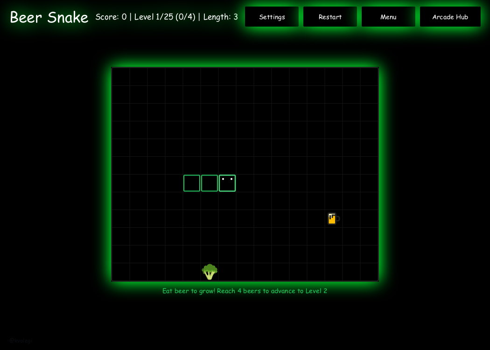 <br> *Beer Snake Game Loop (25 Progression Levels)* | 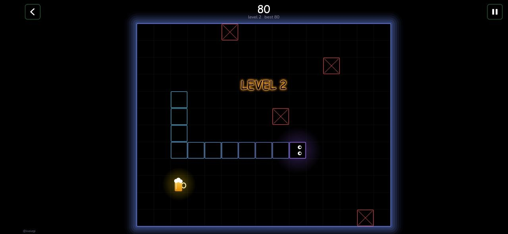 <br> *Beer Snake (Level Progression & Speed Scaling)* |
| 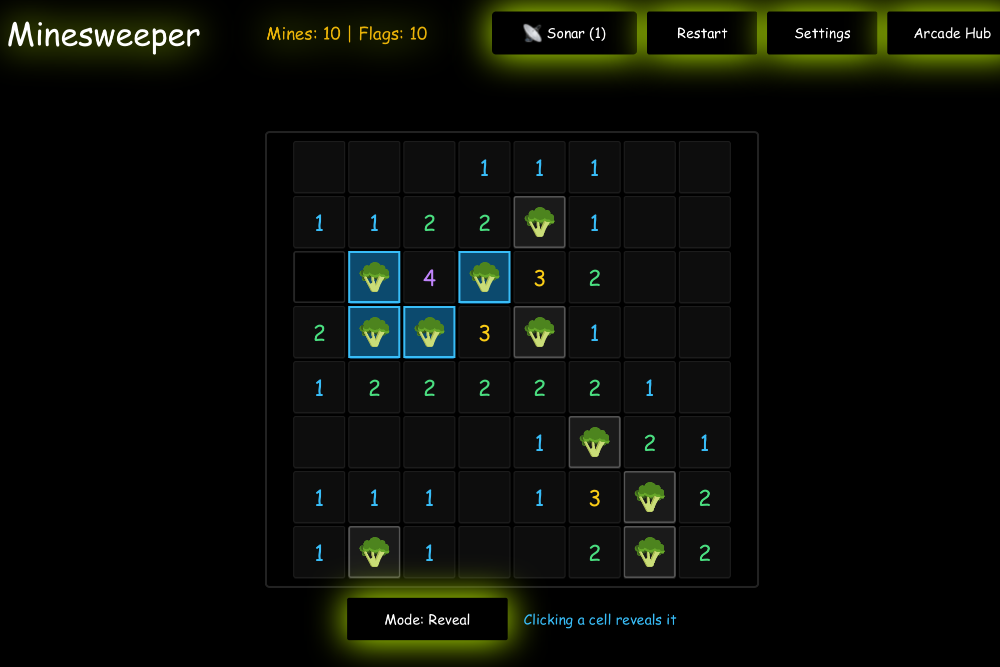 <br> *Bobr Minesweeper (Sonar Radar & Safe First Click)* | 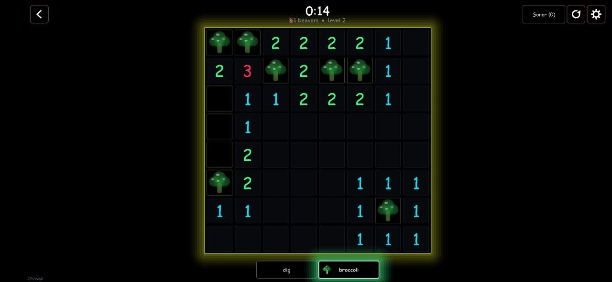 <br> *Bobr Minesweeper (Cascade Area Reveal & Sonar)* |

---

## 🏗️ Architecture & Technical Decisions

For complete technical specifications, see [docs/ARCHITECTURE.md](docs/ARCHITECTURE.md).

### Architecture Decision Records (ADRs)
The project's architectural trade-offs are documented under [docs/adr/](docs/adr/):
- **[ADR-0001: Platform-Agnostic Core via Hexagonal Architecture](docs/adr/0001-platform-agnostic-core.md)** — Zero external runtime dependencies, 100% headless testability.
- **[ADR-0002: Elimination of Runtime GC Pauses in 60 FPS Render Loop](docs/adr/0002-gc-allocation-free-render-loop.md)** — Object reuse, packed ARGB integers, and zero-allocation frame loops.
- **[ADR-0003: Multi-Platform Fat-JAR Distribution](docs/adr/0003-multi-platform-fat-jar.md)** — Bundled multi-OS native bindings in a single executable artifact.

The codebase uses a clean three-tier structure that isolates core game rules from platform presentation:

```
kvolegi-arcade/
├── source/
│   ├── core/                  # Pure Java Standard Library (Zero dependencies)
│   │   └── arcade/            # Game logic, state machines, math, data structures
│   ├── desktop/               # Desktop Frontend (JavaFX 21 + Reactive Controls)
│   │   └── arcade/desktop/    # Hardware-accelerated UI, Window management, Launcher
│   └── android/               # Mobile Frontend (Android Native SDK)
│       └── src/main/java/     # SurfaceView, dedicated 60 FPS RenderThread, Touch dispatch
├── assets/                    # High-res PNG sprites, TTF fonts, audio FX
├── dist/                      # Local distribution binaries (Git-ignored)
│   ├── kvolegi-arcade-mac.jar # Universal cross-platform JAR (Windows / Linux / macOS)
│   ├── kvolegi arcade.app     # Standalone macOS Application Bundle
│   └── kvolegi-arcade.apk     # Signed Release Android APK
└── docs/                      # Screenshots, technical documentation & specifications
```

### 1. Why JavaFX on Desktop?
* **Hardware Acceleration:** JavaFX hooks straight into native GPU backends (Metal/OpenGL on macOS, DirectX on Windows), enabling real-time CSS pseudo-class transitions, neon drop-shadow filters, and fluid window resizing without frame drops.
* **Responsive Layouts:** Hierarchical `BorderPane`, `VBox`, and `GridPane` containers adapt smoothly from 800x600 windowed mode up to 4K displays.
* **Precise Input Handling:** Desktop controls use `setPickOnBounds(false)` overrides so wide 50px Gaussian glow effects do not inflate clickable bounding boxes or cause misclicks.

### 2. Why Native Android SurfaceView instead of Unity or LibGDX?
* **Compact APK Size:** General-purpose game engines add 30–60 MB of overhead. Rendering directly to Android `SurfaceView` and `Canvas` kept the full suite down to **~5.6 MB**.
* **Isolated 60 FPS Loop:** Rendering runs on a dedicated background thread (`ArcadeView.java`) that locks the canvas via double-buffering (`surfaceHolder.lockCanvas()`), keeping heavy drawing separate from the main OS UI thread.
* **Low Memory Churn:** Object reuse and minimal allocations inside the draw loop prevent frequent garbage collection pauses.

### 3. Concurrency & Loom Thread-Safety Model
* **Loom-Safe Synchronization:** Traditional Java `synchronized` blocks pin OS carrier threads when running under Java 21 Project Loom virtual executors. The input state pipeline (`Ui.java`) replaces monitor locks with `java.util.concurrent.locks.ReentrantLock`, ensuring virtual threads can unmount freely without thread pinning.
* **Race-Condition-Free Event Queue:** Mouse pointer coordinates and keyboard events (`ArrayDeque<String>`) are strictly guarded with mutual exclusion locks, preventing concurrent modification exceptions between OS event dispatch threads (AWT/Swing) and the game rendering loop.

### 4. Cross-Platform Build & Code Signing Automation
* **Standalone Python Toolchain (`build_all.py`):** Automatically compiles desktop Java sources, merges multi-platform OpenJFX bindings, constructs Universal Fat JARs, and drives Android DEX compilation (`d8`), resource alignment (`zipalign`), and APK packaging.
* **Automated Code Signing:** Integrates native macOS `codesign` ad-hoc signing (`codesign --force --deep --sign -`) directly into the automated build step, generating launchable `.app` bundles with valid Gatekeeper signatures.

---

## 🧠 Game Logic & Mechanics

### 1. Tic Tac Toe — Dynamic Centered Expansion
Rather than a fixed 3x3 grid, the board grows dynamically:
* **Dynamic Expansion:** The board starts at $5 \times 5$. When over 50% of the cells fill up, the matrix expands by 5 rows and columns up to $25 \times 25$.
* **Center Coordinate Remapping:** Existing moves transfer to the center of the expanded matrix using:
  $$\Delta = \frac{N_{\text{new}} - N_{\text{old}}}{2}, \quad (r', c') = (r + \Delta, c + \Delta)$$
* **Adaptive Scaling:** Cell sizes rescale dynamically to fit available screen space:
  $$\text{cellSize} = \max\left(18, \min\left(88, \frac{\min(W_{\text{avail}}, H_{\text{avail}}) - (N - 1) \cdot \text{gap}}{N}\right)\right)$$
* **Threat-Evaluation AI:**
  The AI checks open-ended lines across four vectors: horizontal $[0, 1]$, vertical $[1, 0]$, main diagonal $[1, 1]$, and anti-diagonal $[1, -1]$. It prioritizes immediate 5-in-a-row wins ($+50,000$ pts), blocks opponent 4-in-a-row threats ($+15,000$ pts), and looks for branching double forks.

### 2. Sigma Slots — Paylines & Probability
* **4 Rows $\times$ 5 Reels Grid:** 20 symbol positions evaluated on each spin across 20 distinct paylines (straight rows, V-shapes, zigzags, and waves).
* **Payout Tiers:**
  * Low tier: Grape, Watermelon, Lemon, Plum, Pineapple ($0.18\times$ to $2.5\times$ bet).
  * Mid tier: Dragonfruit, Banana ($0.35\times$ to $6.0\times$ bet).
  * High tier (WILD): `BIGBANANA` ($1.8\times$ to $12.0\times$ bet, substitutes for standard symbols).
  * Jackpot tier (SCATTER): `BIGWIN` ($4.0\times$ to $30.0\times$ bet).
* **Custom Bet Input:** Players can bump bets by 10 or type an exact wager using a direct numeric dialog.

### 3. Beer Snake — Dual Physics & Difficulty Scaling
* **Level Progression:** 25 stages requiring 4 collectibles each, scaling speed on each tier:
  $$\text{Delay}_{\text{tick}}(L) = \max\left(60\text{ms}, \text{Delay}_{\text{base}} - L \times 5\text{ms}\right)$$
* **Wall Physics:** Toggle between solid walls (fatal boundary collision) and toroidal wrap-around ($x' = (x + \text{cols}) \pmod{\text{cols}}$).

### 4. Bobr Minesweeper — Safe Start & Sonar Pulse
* **Guaranteed First-Click Safety:** The mine matrix generates only after the player clicks, ensuring the starting tile is always safe and opens adjacent blank space.
* **Sonar Pulse:** A tactical ability revealing hidden beaver positions in a $3 \times 3$ area without triggering detonation.

### 5. Algorithmic Complexity & Engineering Matrix

| Subsystem / Engine | Core Algorithm & Pattern | Time Complexity | Space Complexity | Invariants & Guarantees |
| :--- | :--- | :---: | :---: | :--- |
| **Tic Tac Toe Engine** | 4-Vector Directional Scan + Centered Expansion | $O(N)$ move check | $O(N^2)$ matrix | Dynamic grid resize ($5\times 5 \to 25\times 25$) when density $> 50\%$; centered remapping. |
| **Threat-Evaluation AI** | Heuristic Vector Scoring (Win, Block, Fork) | $O(K \cdot N^2)$ | $O(1)$ heap churn | Evaluates vectors $[0,1], [1,0], [1,1], [1,-1]$; zero allocation during evaluation loop. |
| **Sigma Slots Engine** | 20-Payline Matrix Evaluation + Symbol Mapper | $O(L \cdot C)$ ($20 \times 5$) | $O(1)$ allocations | 4x5 reel matrix; Wild substitutions, Scatter multipliers; deterministic RNG distribution. |
| **Beer Snake Loop** | Queue-Based Body Traversal + Toroidal Wrap | $O(1)$ per frame | $O(\text{Length})$ | Toroidal modulo $x' = (x + W) \pmod W$; adaptive speed scaling $\max(60\text{ms}, \text{base} - 5L)$. |
| **Bobr Minesweeper** | Deferred Lazy Placement + BFS Cascade Reveal | $O(R \cdot C)$ cascade | $O(R \cdot C)$ queue | Guaranteed first-click safety (mines seeded post-click); non-detonating $3\times 3$ Sonar pulse. |
| **ArcadeView Render Loop** | Dedicated 60 FPS Double-Buffering RenderThread | $O(\text{Sprites})$ | $O(1)$ frame churn | Direct `SurfaceHolder.lockCanvas()`; zero GC frame pauses; Loom virtual lock-safety. |

---

## 🚀 How to Run

### Option 1: Universal Executable JAR (Windows, Linux, macOS)

The standalone executable JAR `dist/kvolegi-arcade-mac.jar` bundles all multiplatform desktop components and runs seamlessly across Windows, Linux, and macOS:

#### Prerequisites
Java 17 or Java 21+ is required.
* **Windows:**
  Install OpenJDK via winget:
  ```powershell
  winget install EclipseAdoptium.Temurin.21.JRE
  ```
  Or download the installer from [Adoptium](https://adoptium.net).
* **Linux (Ubuntu / Debian / Mint):**
  ```bash
  sudo apt update && sudo apt install openjdk-21-jre
  ```
* **Linux (Fedora / RHEL):**
  ```bash
  sudo dnf install java-21-openjdk
  ```
* **Linux (Arch Linux):**
  ```bash
  sudo pacman -S jre21-openjdk
  ```

#### Launch Command
```bash
java -jar dist/kvolegi-arcade-mac.jar
```

---

### Option 2: Standalone macOS Application (`kvolegi arcade.app`)

For macOS users, a pre-packaged universal application bundle (`.app`) is provided under `dist/`:

1. Open `dist/` in Finder.
2. Double-click **`kvolegi arcade.app`**.
3. **If macOS Gatekeeper flags the app** (unverified developer):
   * **Terminal command:**
     ```bash
     xattr -cr "dist/kvolegi arcade.app"
     ```
   * **Or via Finder:** Right-click `kvolegi arcade.app` $\to$ click **Open** $\to$ confirm **Open** in the security prompt.

---

### Option 3: Android Device (`.apk`)

1. Transfer `dist/kvolegi-arcade.apk` to your phone or tablet (Android 7.0 / API 24 or newer).
2. Open your device's file manager, tap the APK, and confirm installation.
3. Launch **kvolegi arcade** directly from your app drawer.

---

## 📦 Distribution Standards: `dist/` vs `target/`

* **`target/` (Temporary Build Artifacts)**: Contains bytecode (`.class` files), Maven Surefire XML test logs, and intermediate packaging layers. Completely cleared on `mvn clean`.
* **`dist/` (Release Packages)**: Contains ready-to-run deliverables (`.jar`, `.app`, `.apk`).
* **Why Binaries are Not Committed to Git**: In modern software engineering, compiled binaries are excluded from Git repositories to prevent repository bloat and binary merge conflicts. Releases are automatically built and published via **GitHub Releases** using GitHub Actions CI/CD (`.github/workflows/release.yml`).

---

## 🛠️ Building from Source

### Prerequisites
* JDK 17 or JDK 21+
* Maven 3.8+
* Python 3.10+ (for automation scripts)
* Android SDK Platform 35 & Build-Tools 35.0.0 (only if rebuilding the Android APK)

### Run Maven Build
```bash
# Compile and package the desktop JAR
mvn clean package -DskipTests
```

---

## 🧪 Automated Testing

The suite includes an idiomatic **JUnit 5** test suite (75 total tests) integrated directly into Maven Surefire:

```bash
# Run canonical JUnit 5 test suite via Maven (75 tests passing)
mvn test
```

### Test Suite Coverage Matrix (75 Tests across 6 Suites):

| Test Suite | Tests | Target Subsystem | Key Invariants Verified |
| :--- | :---: | :--- | :--- |
| **`AppLifecycleAndMathTest`** | 16 | Lifecycle & Math Utilities | Screen state machine transitions (`MAIN` $\leftrightarrow$ `TTT_MENU` $\leftrightarrow$ `PLAY`), volume persistence, easing (`lerp`, `clamp`, `easeOut`). |
| **`ArcadeDomainTest`** | 11 | Domain & Headless Gfx | Headless canvas rendering pipeline (`Gfx`), vector icon paths, preferences persistence, high-DPI scaling factors. |
| **`TicTacToeEngineTest`** | 12 | Expanding Grid & AI | Expansion triggers ($5\times 5 \to 7\times 7 \to 10\times 10$), 4-axis 5-in-a-row victory detection, heuristic minimax threat weights, turn alternation. |
| **`SnakeEngineTest`** | 12 | Snake Physics & Food | Head/body coordinate tracking, non-occupied cell food spawning, toroidal vs solid walls, drunk speed multipliers. |
| **`SlotsEngineTest`** | 12 | Reel Matrix & RNG | 4x5 grid symbol distribution, 20 payline alignments, Wild & Scatter payout calculations, auto-spin cycle invariant. |
| **`MinesEngineTest`** | 12 | Mine Generation & BFS | First-click safety invariant, recursive flood-fill cascade, broccoli flag toggle, 3 difficulty tiers, Sonar Radar area pulse. |

---

## ⚖️ License & Private Archive Terms

Strictly private personal portfolio archive. No permission is granted to copy, run, distribute, modify, or commercially exploit this software. Published solely for technical assessment, code review, and portfolio evaluation.

Copyright (c) 2023–2026 **kvolegi** (@kvolegi). All Rights Reserved.  
For full legal terms, see [LICENSE](LICENSE).
