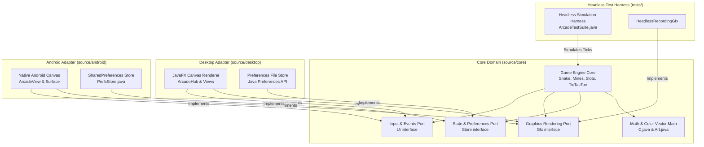

# Architecture Specification: kvolegi-arcade

## Executive Overview
`kvolegi-arcade` is an engineered cross-platform 2D retro arcade suite built with **Zero External Game Engine Dependencies**. Instead of pulling multi-megabyte third-party engines (such as Unity or LibGDX), the project implements a clean **Hexagonal (Ports & Adapters)** architecture in pure Java.

The entire core game logic, mathematical vectors, particle simulation, and physics are 100% decoupled from any windowing toolkit or operating system API.

---

## Architectural Topology: Ports and Adapters

---

## Core Design Principles

### 1. Platform-Agnostic Retained Core (`source/core`)
- Contains no references to `javafx.*`, `java.awt.*`, `android.*`, or third-party frameworks.
- The `Gfx` interface exposes pure vector drawing primitives:
  - Shapes: `rect`, `roundRect`, `oval`, `line`, `strokeRect`
  - Colors: 32-bit ARGB packed integers
  - Typography: `text`, `textBounds`
  - Bitmaps: `image`, `atlas`

### 2. Zero-Allocation Frame Loop (60 FPS Performance Discipline)
- Memory allocations in `Game.frame(Gfx g, float dt, float w, float h)` are strictly guarded against runtime churn.
- Object pools and pre-allocated primitive arrays (`float[] parts`, fixed coordinate matrices) prevent Garbage Collector (GC) pressure.
- Smooth 60 FPS animation is achieved on low-powered mobile devices and older desktop hardware without Stop-The-World GC stutter.

### 3. Deterministic Delta-Time Simulation
- Game physics and particle updates consume explicit delta time (`float dt`).
- Physics ticks behave identically regardless of whether the display runs at 60 Hz, 120 Hz, or 144 Hz ProMotion displays.

### 4. Cross-Platform Native Packaging
- Single universal JAR bundle contains native binaries for:
  - macOS (Apple Silicon `aarch64` and Intel `x86_64`)
  - Linux (`x86_64`)
  - Windows (`x86_64`)
- Standalone macOS `.app` bundle with Gatekeeper isolation fixes.
- Android APK with native Activity lifecycle support.
